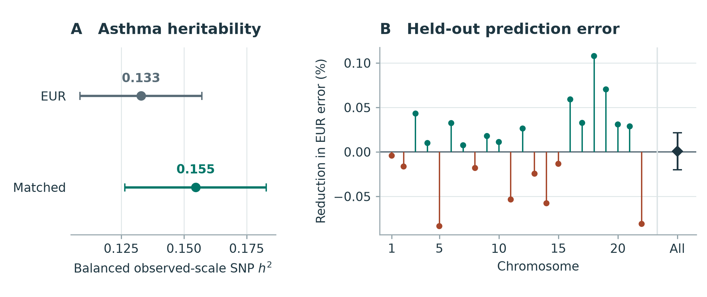

# PLDSC

PLDSC provides fast LD Score regression (LDSC) for SNP heritability and
bivariate LDSC for genetic correlation. Its regression kernels are adapted
from LDpred3 and bipred; optional Numba compilation accelerates block
jackknifing. [Allelign](https://github.com/bvilhjal/allelign) loads, filters
and aligns GWAS summary statistics to the reference alleles.

The package also includes tools and research on LD scores in structured and
multi-ancestry populations. Its API may still change before version 1.0.

**[Which LD score matches a GWAS?](report/methods.pdf)**
([read online](report/methods.md)). The unified report connects ordinary
LDSC to multi-ancestry meta-analysis, the simulation results, the GBMI
asthma application, and the earlier investigations into mixed models,
relatedness, enrichment, assortative mating and parental effects.

## Install and run

With Python 3.11 or newer, clone the repository and install it:

```bash
git clone https://github.com/bvilhjal/PLDSC.git
cd PLDSC
python -m pip install ".[fast]"
```

Allelign and NumPy are installed as dependencies. The `fast` extra installs
Numba; without it, `python -m pip install .` uses the NumPy implementation.
The first accelerated call includes compilation overhead.

Create synthetic inputs in a new directory and run both analyses:

```bash
python examples/ordinary_ldsc.py --out-dir demo-data

pldsc h2 --sumstats demo-data/trait1.tsv.gz \
  --reference demo-data/reference.bim \
  --ld-scores demo-data/reference.ldscores.npy --m-snps 4000 \
  --n-blocks 40 --out demo-data/h2.json

pldsc rg --sumstats1 demo-data/trait1.tsv.gz --sumstats2 demo-data/trait2.tsv.gz \
  --reference demo-data/reference.bim \
  --ld-scores demo-data/reference.ldscores.npy --m-snps 4000 \
  --n-blocks 40 --ncores 2 --out demo-data/rg.json
```

The example also prints the estimates and QC logs. Its independent synthetic
z scores illustrate the workflow; they do not establish calibration. The
JSON files include processing and alignment counts as well as the estimates.

For real data, use reference LD scores appropriate to the populations and
genome build, in exactly the order of the reference variants. `--m-snps` is
the number of variants summed into each LD score, not the number of GWAS
rows retained after filtering. Check the QC and alignment logs before
interpreting estimates. PLDSC does not verify genome builds or perform
liftover.

## Guides

- [LDSC guide](docs/LDSC.md): real-data inputs, command-line options,
  allelign QC, Python APIs, interpretation and performance.
- [Runnable notebook](examples/ldsc_notebook.ipynb): create example GWAS,
  preprocess them with allelign and fit both models.
- [Contributing](CONTRIBUTING.md): development setup and checks.

## Multi-ancestry research

On 1000 Genomes chromosome 22, a 75% EUR and 25% AFR composition with
effect correlation 0.8 gives a panel plug-in slope ratio of 0.750. Only
1.98% of the matched predictor's variation remains after rescaling the EUR
predictor. On 953,596 GBMI asthma SNPs, the fixed-correlation matched score
raised the heritability estimate from 0.133 to 0.155. Its prediction error
on held-out chromosomes fell by 0.0007% (95% interval −0.020% to +0.022%).
In simulations with known LD, the power to detect the matched pattern rose
from 12% at a 90:10 mix to 99% at 50:50, holding total sample size fixed.
[Asthma prediction](report/methods.md#61-can-the-scores-predict-an-unseen-chromosome),
[power study](report/methods.md#10-when-can-the-two-scores-be-distinguished)
and [full multi-ancestry derivation](docs/MULTI_ANCESTRY.md).



**Figure 2 from the report.** Each point on the right holds out a whole
chromosome. The diamond pools the errors on all 953,596 SNPs.

A meta-analysis also reports Cochran's Q, which is the other half of a
rotation of the two ancestry statistics. In simulations on 1000 Genomes LD
the pooled statistic and Q together recovered the cross-ancestry genetic
covariance, at 1.7 times the standard deviation of the two-strata estimate
for an 85% EUR study. In asthma the fit matched the two-strata estimate
under sample-size weights. Under inverse-variance weights it fell 22% below
it, but that fit lets unequal stratum intercepts leak into the covariance;
the 22% is provisional until a refit with three stratum intercepts. [What does Cochran's Q add?](report/methods.md#11-what-does-cochrans-q-add)

Reproduce the chromosome 22 tables from the committed aggregate LD-score
bundle, without downloading genotypes:

```bash
python examples/reproduce_chr22_tables.py
```

See the [experiment index](experiments/README.md) for simulations, data
requirements and historical results, and the [reading guide](docs/READING_ORDER.md)
for the current research and the archived estimator line.
