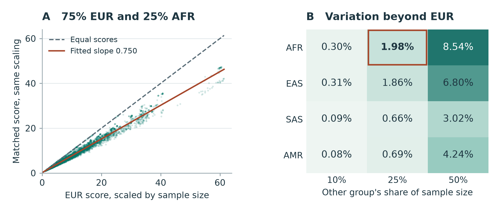
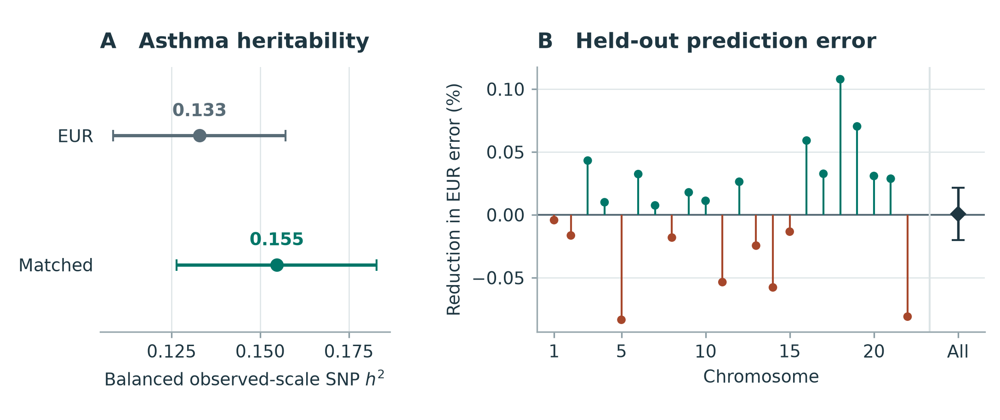
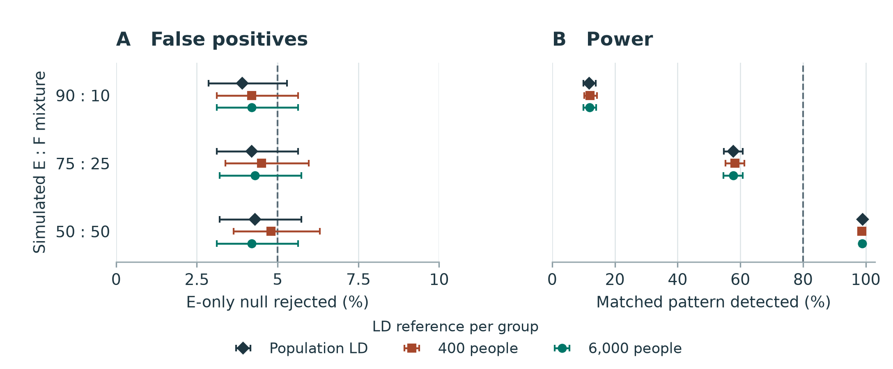

# Which LD score matches a GWAS?

**PLDSC methods, simulations and applications**\
19 November 2026 · PLDSC 0.1.2

A variant can show association because it tags causal variants nearby. An LD score measures this tagging. The complication is that the same variant tags different neighbours in different populations, and a GWAS can combine those populations in several ways. PLDSC asks how much the choice of reference changes what one learns about SNP heritability from the resulting summary statistics.

Consider a study with 75% European and 25% African ancestry and a cross-ancestry effect correlation of 0.8. On 1000 Genomes chromosome 22, regressing its panel-derived matched score on the European score gives a slope of 0.750. Yet only 2% of the matched predictor's variation remains after fitting an intercept and rescaling the European predictor. A substantial change in the reported heritability can therefore coexist with little information about which model better describes the GWAS. Figure 1 shows both quantities.

The GBMI asthma reanalysis illustrates the distinction on a real trait. Changing the reference moved the estimate from 0.133 to 0.156 under the original central sharing assumptions. In a subsequent test with sharing fixed across all groups, each score predicted association statistics on chromosomes excluded from fitting. The matched score reduced prediction error by 0.0007% (95% interval $-0.020\%$ to +0.022%). A known-truth experiment explains why even a genome-wide study can struggle to choose between the scores when one group dominates the sample.

Table 1 traces the argument from the association statistic to prediction on held-out chromosomes and a test in an independent cohort.

**Table 1. Research questions and evidence.**

| Question | Evidence in this report |
|:----------------|:------------------------|
| What does the software estimate? | The univariate and cross-trait slopes, their scale and uncertainty. [Section 1](#1-ordinary-ldsc-and-its-estimands) |
| Which score describes a meta-analysis? | Derivation, simulation against known truth and two reference protocols. [Sections 2–5](#2-how-a-meta-analysis-changes-the-score) |
| Does the choice matter for a published result? | The same asthma statistics fitted with both scores, followed by a chromosome prediction test. [Section 6](#6-what-changed-in-the-gbmi-asthma-analysis) |
| What else can create the same signal? | Mixed models, relatives, enrichment, assortative mating and parental effects. [Sections 7–9](#7-a-matched-mixed-model-score-and-the-reason-to-archive-it) |
| How could the model be falsified? | Power and false positives against known truth, followed by a cohort-level test. [Section 10](#10-when-can-the-two-scores-be-distinguished) |

## 1. Ordinary LDSC and its estimands

Let $z_{tj}$ be the signed association statistic for variant $j$ and trait $t$, and $N_{tj}$ its effective sample size. In a matched reference, $r_{jk}$ is the correlation between genotypes at $j$ and $k$. Write $\mathcal M$ for the modeled variant set, $M$ for its size, and take each phenotype to have unit variance. If standardized effects have common variance $h_t^2/M$ and are uncorrelated across loci, the ordinary LDSC approximation is

$$
\ell_j=\sum_{k\in\mathcal M} r_{jk}^2,\qquad
E[z_{tj}^2\mid\ell_j]\simeq a_t+\frac{N_{tj}\ell_j}{M}h_t^2. \tag{1}
$$

Equation (1) predicts larger test statistics at variants tagging more neighbours. Its slope estimates additive SNP heritability on the specified scale under the effect and reference assumptions. With two traits, align the signs of the two effects to the same allele and fit the marginal and cross moments on the same variants. For genetic covariance $g_{12}$ and genetic correlation $r_g$, the corresponding equations are

$$
E[z_{1j}z_{2j}\mid\ell_j]\simeq a_{12}
+\frac{\sqrt{N_{1j}N_{2j}}\,\ell_j}{M}g_{12},\qquad
r_g=\frac{g_{12}}{\sqrt{h_1^2h_2^2}}. \tag{2}
$$

The free intercepts allow LD-independent shifts. Sample overlap can contribute to $a_{12}$, as can correlated confounding. Its value alone cannot separate these sources. A one-trait fit may retain a different set of SNPs from the two-trait fit and return a different marginal estimate. [Univariate LDSC](https://doi.org/10.1038/ng.3211) and [cross-trait LDSC](https://doi.org/10.1038/ng.3406).

**Fitting and uncertainty.** PLDSC uses one-step iteratively reweighted regression with two weight updates by default. Let $d_j=\max(\ell_j,1)$, $\mu_{tj}$ be the fitted marginal mean floored at one, and $q_j$ the fitted cross mean. The marginal weight is $1/(2d_j\mu_{tj}^2)$. The cross weight is $1/[d_j\max(\mu_{1j}\mu_{2j}+q_j^2,10^{-6})]$. Each genomic deletion refits the weights and, for $r_g$, all three slopes. For $B$ contiguous blocks and delete-block estimates $\theta_{-b}$ with mean $\bar\theta_-$, Equation (3) gives the reported uncertainty.

$$
\operatorname{SE}_{\rm JK}(\hat\theta)=
\sqrt{\frac{B-1}{B}\sum_{b=1}^{B}(\theta_{-b}-\bar\theta_-)^2}. \tag{3}
$$

The defaults are 100 blocks for one trait and 200 for two. Estimates can fall outside their population ranges. A nonpositive marginal heritability makes $r_g$ undefined. An invalid deletion makes its SE undefined. A fixed cross intercept in the bivariate fit leaves the two marginal intercepts free.

**Choosing a scale.** Removing regression rows leaves $M$ fixed. For the bundled GRCh37 HapMap3 EUR scores, PLDSC defaults to $M=9{,}997{,}231$ reference variants. The original LDSC common-variant count is 5,961,159. At identical fitted slopes their ratio directly rescales both $h^2$ and $g_{12}$ and cancels in $r_g$. Binary-trait estimates require an explicit prevalence, sampling convention and conversion to report them on the liability scale. Section 11 gives the software entry points.

## 2. How a meta-analysis changes the score

Consider one trait measured in independent ancestry strata. Within each stratum assume population structure is controlled, phenotypes are standardized and all panels count the same allele. At each causal variant let the standardized effects in groups $a,b$ have covariance $\rho_{ab}h_a h_b/M$, with $h_a=\sqrt{h_a^2}$. Effects at different variants are uncorrelated. Here $\rho_{ab}$ measures sharing of one trait's effects across groups. Equation (2) instead compares two traits. For stratum sizes $N_a$ and signed LD correlations $r^a_{jk}$, the building blocks are

$$
\ell_j^{ab}=\sum_k r^a_{jk}r^b_{jk},\qquad
E[z_{aj}z_{bj}]\simeq {\bf 1}_{a=b}
+\frac{\sqrt{N_aN_b}}{M}\rho_{ab}h_a h_b\,\ell_j^{ab}. \tag{4}
$$

The diagonal contains ordinary LD scores. An off-diagonal term is large when the same alleles tag the same causal variants in both groups with concordant signs. Popcorn distinguishes effects per allele from effects per genotype SD. PLDSC's baseline uses the latter (genetic-impact scale). S-LDXR models per-allele effects, with allele-frequency factors in its scores. Its reported correlation cannot in general be inserted unchanged into the baseline. [Brown et al.](https://doi.org/10.1016/j.ajhg.2016.05.001) and [Shi et al.](https://pmc.ncbi.nlm.nih.gov/articles/PMC7889654/).

Let the meta-analysis report $z_j=\sum_a c_{aj}z_{aj}$, where $\sum_a c_{aj}^2=1$, and $N_j$ is the sum of contributing sample sizes at $j$. Set $\eta_a=h_a^2/h^2$ relative to a specified reference heritability $h^2$. Squaring the weighted sum and substituting Equation (4) gives

$$
\begin{aligned}
 E[z_j^2]&\simeq 1+\frac{N_jh^2}{M} L_j,\\
 L_j&=\sum_{a,b}c_{aj}c_{bj}\frac{\sqrt{N_aN_b}}{N_j}
      \rho_{ab}\sqrt{\eta_a\eta_b}\,\ell_j^{ab}.
\end{aligned}\tag{5}
$$

For sample-size weighting $c_{aj}^2=f_a=N_a/N_j$. Two groups then contribute $f_a^2\ell^{aa}$, $f_b^2\ell^{bb}$ and $2f_af_b\rho_{ab}\ell^{ab}$ when $\eta=1$. Averaging only the two ordinary scores omits the cross term and gives the wrong weights to the other two. For inverse-variance weighting of per-allele effects (IVW), $c_{aj}^2$ is proportional to $N_a\sigma_{aj}^2$ under the simple standardized quantitative-trait model, where $\sigma_{aj}$ is the genotype SD. Availability, imputation and effective $N$ can all make actual weights vary across SNPs. Overlapping samples require a corresponding cross-stratum noise covariance in Equation (4).

**A useful bound.** For population scores with $\eta=1$ and nonnegative weights, Equation (5) gives $L_j\leq\sum_a f_a\ell_j^{aa}$ under either scheme. Cauchy–Schwarz gives the tighter intermediate bound $(\sum_a f_a\sqrt{\ell_j^{aa}})^2$ for sample-size weights. For IVW its counterpart is $(\sum_a f_a\sigma_{aj}\sqrt{\ell_j^{aa}})^2/\sum_a f_a\sigma_{aj}^2$. A bound on a score at a SNP does not determine a regression slope across SNPs.

**Pooled individuals.** With exactly the group indicators as covariates, within-group centering makes the pooled in-sample tagging score equal the IVW meta score, using the same genotypes and uncorrected LD. With partial adjustment, between-group allele-frequency differences can survive in the pooled statistic. Additional covariates and continuous admixture require their actual residualization. [Pooled-score derivation, MA10–MA12](../docs/MULTI_ANCESTRY.md) and [Lin and Zeng](https://pubmed.ncbi.nlm.nih.gov/19847795/).

## 3. A wrong reference and a known-truth experiment

Let $x_L=(N_j/\bar N)L_j$ be the correct predictor and $x_R=(N_j/\bar N)\ell_j^R$ the predictor actually used. If the expected statistic is $1+s x_L$ with $s=\bar Nh^2/M$, a regression with an intercept and fixed weights $w$ gives

$$
\kappa=\frac{\operatorname{Cov}_w(x_R,x_L)}{\operatorname{Var}_w(x_R)},\qquad
b_R=s\kappa,\qquad a_R=1+s(\bar x_{L,w}-\kappa\bar x_{R,w}). \tag{6}
$$

Equation (6) is a population projection. Substituting a finite-panel estimate for $L$ gives a *panel plug-in* $\kappa$. The same EUR genomes can contribute errors to both predictors. A ratio close to that plug-in is therefore a weak test of recovery of the underlying $h^2$.

PLDSC subtracts $(1-\hat r^2)/(n-2)$ from each within-panel squared correlation for unrelated individuals with only an intercept. This removes the familiar positive null floor under independent Gaussian data. Off-diagonal terms multiply signed correlations from independent panels and have no corresponding additive null floor. Noisy estimates of nonzero LD persist in both cases. In a separate control, both populations had identical block LD and perfectly correlated effects. Across 30 independent draws of two 500-person panels, the plug-in averaged 0.969 while the slopes against the **known expectation** recovered 0.917 (EUR) and 0.959 (matched) of truth. The population mismatch factor was exactly one. [Noise-control experiment](../experiments/reference_score_noise.py) and [theory of finite-reference LDSC](https://doi.org/10.1214/25-AOS2523).

Table 2 asks whether a fitted GWAS slope recovers known heritability as the reference panel grows.

**Table 2. Mean estimated heritability divided by true heritability in independent-reference simulations.** The final columns use 6,000-person panels and compare the observed ratio of mean slopes to its plug-in prediction. E and F denote simulated groups.

| GWAS composition | True $\rho$ | Weights | Matched, 400 | Matched, 6,000 | E-only / matched | Plug-in |
|:-------|---:|:------|----:|----:|------:|---:|
| E only | 1.0 | Sample size | 0.797 | 1.041 | 1.000 | 1.000 |
| 2 E to 1 F | 1.0 | Sample size | 0.822 | 0.966 | 0.608 | 0.610 |
| 2 E to 1 F | 0.6 | Sample size | 0.821 | 1.047 | 0.547 | 0.548 |
| 2 E to 1 F | 1.0 | IVW | 0.852 | 0.994 | 0.738 | 0.742 |
| 2 E to 1 F | 0.6 | IVW | 0.866 | 0.962 | 0.679 | 0.681 |

Table 2 uses 2,000 SNPs, 3,000 E and up to 1,500 F participants, $h^2=0.5$, shared ancestral frequencies, different LD lengths and OLS. Each of three independently generated genotype and reference sets had 100 phenotype draws per arm. The displayed driver SEs for the large-panel matched fits are 0.022–0.031 when pooling phenotype draws. Only three independent panel realizations contribute to each mean.

At 400 reference individuals per group both original absolute-calibration checks failed. Even the E-only control was attenuated. The ratio agreement seen afterwards motivated a new rule. At 6,000, the rerun met its separately stated 5% absolute-recovery and 0.03 slope-ratio tolerances. This establishes recovery in those arms. The small-panel result is the relevant warning for reference panels numbering in the hundreds. [Simulation protocol and driver](../experiments/multiancestry_meta_sim.py).

## 4. What the chromosome 22 panels show

The first empirical study uses phased 1000 Genomes phase 3 genotypes, every tenth biallelic SNP, and windows of $\pm1$ cM on a common GRCh37 map. EUR, AFR, EAS, SAS and AMR are the panel's European, African, East Asian, South Asian and admixed American superpopulation labels. These labels describe reference groups. In particular, they do not imply homogeneity within a group. The bundle has 9,654 regression candidates with full-panel minor allele frequency (MAF) at least 0.05. The corrected EUR-reference comparison retains 7,837 that are also common in EUR. The assumed GWAS reports a SNP in a group when it is polymorphic with MAF at least 0.01.

Mean within-panel scores across the 9,654 candidates are 9.76 in EUR, 7.32 in AFR and 8.64 in EAS. The EUR–AFR cross score averages 5.08, compared with 6.68 for EUR–EAS. These means illustrate tagging differences. Equation (6) uses *covariance across variants* to predict a slope. Figure 1 shows the two scores for individual SNPs and how much the matched pattern changes as the EUR share declines, holding $\rho=0.8$, $\eta=1$ and the sample-size weighting scheme fixed.

**Figure 1. A large slope change can leave little variation with which to test the choice of reference.** In A, each dot is one of 7,837 SNPs. Both axes include the factor $N_j/\bar N$. The dashed line marks equal scores and the solid line is the fitted regression with a free intercept. In B, each cell gives $100[1-\operatorname{corr}(x_L,x_R)^2]$. The outlined cell is the mixture shown in A. All points and cells come from the [distributed bundle](../examples/mini) and [figure code](reference_figure.py).

At 25% AFR the slope is 0.750, but only 1.98% of matched-score variation is distinct from the EUR predictor. At 50% AFR the figures are 0.592 and 8.54%. A small slope and a high correlation are compatible because correlation ignores changes in scale. Residual score variance measures the opportunity to compare predicted patterns. It includes sampling noise from the panel and does not by itself measure power or biological signal.

The original rule required $|\kappa-1|\geq0.10$ in at least one 75% EUR comparison. It passed. Its initial implementation treated $N$ as constant and admitted SNPs rare or missing in EUR. Correcting both changed the AFR value from 0.716 to 0.750 and left the decision intact. With $\rho=1$ the corrected value is still 0.788. A denser 1-in-3 panel gives 0.743 at $\rho=0.8$. [Complete grid, corrections and panel provenance](../docs/MULTI_ANCESTRY.md).

## 5. From one chromosome to 22 autosomes

A second protocol used the bigsnpr set of 2,490 people, with roughly 1.66 million common reference variants. It retained 1,190,723 EUR-common regression SNPs outside the MHC on the 22 autosomes. Table 3 compares the protocols at the original rule cell. Simplified LDSC weights downweight high-LD and high-expected-$\chi^2$ SNPs. The reported standard errors describe variation across 200 genomic blocks conditional on the panel.

**Table 3. EUR-reference plug-in slopes for 75% EUR plus one other group.** Standardized effects have equal variance across SNPs and groups, with cross-group correlation 0.8.

| Other 25% | Chr22 OLS | Chr22 weighted | Autosomes OLS (SE) | Autosomes weighted |
|:--|--:|--:|--:|--:|
| AFR | 0.750 | 0.750 | 0.737 (0.005) | 0.726 |
| EAS | 0.841 | 0.845 | 0.846 (0.008) | 0.837 |
| SAS | 0.868 | 0.870 | 0.877 (0.005) | 0.866 |
| AMR | 0.907 | 0.896 | 0.896 (0.004) | 0.891 |

The genome-wide AFR criterion ($\kappa\leq0.90$ under both fits) passed. A separate comparison used the *same chromosomes* on both variant sets. The largest OLS discrepancy was 0.039 on chromosome 10 for AFR, above the prespecified 0.03 tolerance. Thus the two columns describe their respective sets. Their close aggregate values do not establish interchangeability. Fixing the regression set alone at HapMap3 changed the reported genome-wide ratios by at most 0.002; changing which variants enter the tagging sum is a different intervention. [Genome-wide protocol](../experiments/multiancestry_genome_kappa.py).

**Effect-scale sensitivity.** Common standardized-effect variance implies larger per-allele effects at low frequencies. An alternative makes per-allele effect variance proportional to $[\bar p_k(1-\bar p_k)]^\alpha$, with $\bar p_k$ the pooled reference frequency. Each population then scales the effect by its own genotype SD. The assumed $\rho$ is now a per-allele parameter. The reported comparison is $\pi=\kappa_{\rm meta}/\kappa_{\rm EUR}$ under the *same* architecture. This removes the EUR-only architecture shift. The empirical $\alpha=-0.38$ motivates a sensitivity model rather than a universal trait parameter. [Schoech et al.](https://doi.org/10.1038/s41467-019-08424-6).

Table 4 compares the original architecture with two frequency-dependent alternatives.

**Table 4. Effect-model sensitivity for 75% EUR and 25% AFR.** Both columns use bigsnpr variants, so the chromosome 22 baseline differs from Table 3. Each entry gives OLS / weighted $\pi$.

| Effect model | Chr22 | All autosomes |
|:--|--:|--:|
| Constant standardized-effect variance | 0.732 / 0.732 | 0.737 / 0.726 |
| Per-allele variance, $\alpha=-1$ | 0.693 / 0.700 | 0.707 / 0.703 |
| Per-allele variance, $\alpha=-0.38$ | 0.699 / 0.709 | 0.716 / 0.711 |

Table 4 preserves both decisions. The chromosome 22 rule tested both $\alpha$ values and both fits and missed its tolerance (largest difference 0.039). The subsequently specified genome-wide rule for $\alpha=-0.38$ passed the 0.03 tolerance. The tested architectures gave slightly lower ratios. Ancestry-specific maps, other architectures and variation in relative heritability remain consequential possibilities. For example, taking $\eta_{\rm AFR}=0.8$ or 1.25 in the baseline model gives genome-wide OLS values of 0.716 or 0.761. [Effect-model protocol](../experiments/multiancestry_alpha_kappa.py).

## 6. What changed in the GBMI asthma analysis?

The Global Biobank Meta-analysis Initiative (GBMI) reported liability-scale SNP heritability of 0.085 for asthma using UK Biobank European LD scores. PLDSC asks a narrower question, using the May 2021 all-biobank summary statistics and five ancestry-specific releases. What happens when only the predictor changes on a common set of 953,596 regression SNPs? The estimated effective-sample composition was approximately 80% EUR and 14% EAS, with each remaining group contributing at most 3%. [GBMI consortium analysis](https://doi.org/10.1016/j.xgen.2022.100192) and [GBMI asthma study](https://doi.org/10.1016/j.xgen.2022.100212).

The reanalysis joined GRCh38 GWAS files to GRCh37 scores by rsID, excluding flagged SNPs and checking direct or swapped stratum alleles against the all-biobank file. It inferred effective $N_j$ from standard errors and allele frequency. Both fits used identical SNPs, weights, blocks and all-biobank $N_j$. The matched predictor used stratum-specific information for IVW and assumed equal heritabilities. Only EUR–EAS met the two marginal $h^2$ signal requirements for estimating $\rho$ ($0.755$, SE $0.046$). Other pairs shared a sensitivity value. The upper bound 0.901 kept the full and all delete-block correlation matrices positive semidefinite.

Table 5 applies that bracket to the same all-biobank statistics.

**Table 5. Asthma estimates on the balanced observed scale.** The last column expresses each change from the EUR-reference fit in units of that fit's SE, the denominator fixed before analysis.

| Reference for all-biobank GWAS | Other pairs' $\rho$ | $\hat h^2$ (SE) | Shift / EUR SE |
|:--|--:|--:|--:|
| 1000G EUR | — | 0.1329 (0.0122) | — |
| Matched IVW | 0.600 | 0.1593 (0.0145) | 2.2 |
| Matched IVW | 0.800 | 0.1559 (0.0142) | 1.9 |
| Matched IVW | 0.901 | 0.1543 (0.0141) | 1.8 |

Table 5 answers two questions with different denominators. At the central assumption the paired difference is $+0.023$ (paired SE 0.0023). The deletion refits the estimated EUR–EAS $\rho$ and holds the panels and eligibility rule fixed. This measures the precision of changing scores on these data. The original practical threshold of two EUR-fit SEs was crossed only at the low end of the valid bracket. Using the smaller paired SE to declare that threshold passed would change the question after observing the answer.

The observed EUR/matched estimate ratio of 0.852 is close to the plug-in 0.850. But the two $N_j$-scaled predictors correlate 0.9965. A post hoc composition-weighted mean of matched stratum estimates was 0.154 (approximate SE 0.012 treating strata as independent). Those strata contribute to the same meta-analysis and use the same panel resources. Both comparisons are informative about consistency. Neither supplies an independent value of asthma heritability.

At GBMI's prevalence of about 0.085, the conversion factor from the balanced scale is close to one. Reference density, effective-$N$ convention and variant selection still differ from the published analysis. The difference between 0.133 and the published 0.085 cannot be assigned to ancestry composition. [Reanalysis code and file digests](../experiments/gbmi_asthma_casualty.py) and [case-control meta-analysis scaling](https://pmc.ncbi.nlm.nih.gov/articles/PMC10066905/).

### 6.1 Can the scores predict an unseen chromosome?

We returned to the same 953,596 asthma SNPs for an exploratory prediction test. This time all cross-ancestry correlations were fixed at 0.8, including EUR–EAS. For each score we fitted an intercept and slope on 21 autosomes, then predicted $z^2$ on the chromosome left out. Both fits used the same inverse-LD weights and predictors $N_j\ell_j/M$ or $N_jL_j/M$. The historical filter screened extreme $z^2$ before folding, using each file's median effective $N$ among eligible SNPs. Figure 2 compares the estimates and prediction errors.

**Figure 2. Changing the heritability scale has little effect on held-out asthma prediction.** A gives the genome-wide estimates with 95% chromosome-jackknife intervals. B gives each chromosome's percentage reduction in weighted squared prediction error relative to EUR. Positive values favour the matched score. The diamond pools errors across SNPs. For its interval, each chromosome deletion refits every remaining training fold; both panels use a $t_{21}$ critical value. [Chromosome counts, cross-products and held-out errors](asthma_score_shape.json).

The EUR and matched fits gave 0.1329 and 0.1547. The matched score had lower error on 13 of 22 chromosomes. The pooled reduction was **0.0007%** (95% interval **$-0.020\%$ to +0.022%**). Only 0.734% of the matched predictor's weighted variation remained after rescaling EUR. The coefficient on that remainder was 0.082 (95% interval $-0.126$ to 0.290). This interval covers both zero and the marginal matched slope. The residual slope minus the marginal matched slope was $-0.073$ (95% interval $-0.283$ to 0.138).

**How much improvement could one expect?** If the measured matched score described the mean exactly, with slope $b=0.1547$, its expected squared-error advantage over the best affine EUR prediction would be $b^2\operatorname{Var}_w(u)$, where $u$ is the residual score in Equation (11). On these SNPs this amounts to **0.0082%** of the observed EUR prediction error, also inside the interval. This benchmark uses the fitted slope and conditions on the reference panel. The folds share participants, phenotype definition, summary-statistic QC and reference people. Replication in a separate cohort and an independent heritability target answer different questions.

## 7. A matched mixed-model score and the reason to archive it

The original PLDSC idea starts one step earlier, with the association test itself. Let $X$ contain target-chromosome genotypes, $C$ the fixed covariates and $V_c$ the residual covariance from a genomic relationship matrix (GRM) constructed leaving chromosome $c$ out (LOCO). For fixed $V_c$, let $W=V_c^{-1}$ and form the residual precision $P_c$. Equations (7)–(8) give the score statistic and its expectation when the target effects have independent variances $\tau_k^2$ and residuals have covariance $V_c$.

$$
P_c=W-WC(C^TWC)^+C^TW,\qquad q_j=x_j^TP_cx_j,\qquad
z_j=\frac{x_j^TP_c y}{\sqrt{q_j}}. \tag{7}
$$

$$
E[z_j^2\mid X,V_c]=1+\sum_{k}\tau_k^2
             \frac{(x_j^TP_c x_k)^2}{q_j}. \tag{8}
$$

Here $+$ denotes the Moore–Penrose inverse and $q_j>0$. Since $P_cV_cP_c=P_c$, the null contribution is exactly one. With common $\tau_k^2$, the slope on the matched row sum in (8) estimates per-variant effect variance. A whitened correlation score such as WhiLD also rescales the causal genotypes to unit norm, changing this target when their $q_k$ differ. Estimating $V_c$ from the phenotype adds uncertainty. Table 6 tests the practical value of matching the operator. [Mangin et al.](https://pubmed.ncbi.nlm.nih.gov/21878986/) and [full derivation](../docs/METHOD.md).

**Table 6. Simulations distinguish null calibration at association from the downstream windowed LDSC fit.**

| Experiment | Observation | Interpretation |
|:--------|:-------------|:------------|
| Null target chromosome, $N=400$, realized $F_{ST}=0.080$, relatives present | Mean $z^2$ was 2.25 for OLS, 1.08 with two LOCO PCs, and 1.00 for oracle $P_c$. The unstructured control gave 1.00, 0.98 and 1.00. | PCs removed most structure. A matched residual covariance also handled the remaining relatedness. |
| Covariance fitted by REML, 300 null replicates | Mean fitted-operator null statistic 1.010, SD 0.078. A separate 80-SNP toy gave 95.0% intercept and 94.3% slope interval coverage. | The coverage experiment used delete-one-SNP blocks with weak dependence. Genome-wide coverage and external GEMMA score-test parity are open. |
| Downstream local scores, $F_{ST}=0.15$ | Slope relative to the homogeneous baseline was 0.69 for ordinary LD, 1.00 with two PCs and 1.02 for the oracle. | The comparator already recovered the baseline slope. A separate sib-pair sweep gave little downstream effect. |

The corrected first row uses a common ancestral frequency spectrum. An earlier simulator inflated even its homogeneous control; the revised null excess for ordinary OLS was 1.25. Deliberate GRM undercoverage could also push the matched null statistic to 3.19 in one thinning experiment. An identity with the true covariance offers no protection against that error. [Experimental record](../experiments/RESULTS.md).

For full siblings, subtracting the family mean makes the expected pedigree covariance a scalar on the remaining contrasts. With consistently scaled uncertainty, the within-family fixed-effect fit and the pedigree-weighted fit both recovered the simulated target. These tests explain the archive decision. No advantage over PC-adjusted local scores or over the standard full-sib comparator was demonstrated for the intended application. [cov-LDSC](https://pubmed.ncbi.nlm.nih.gov/33987664/) and [within-family comparison](../experiments/within_family_killtest.py).

## 8. Structure, enrichment and relatives in the reference panel

**Where is the apparent structure?** One can recompute squared correlations after projecting out PCs or whitening by $P_c$, and subtract their row sums from ordinary LD scores. This difference depends on the operator and can be negative. A GRM built from the test chromosome also whitens genuine local linkage. A LOCO GRM avoids this particular reuse. In the simulation the difference for unrestricted LD correlated 0.99 with a top-ten-PC score, yet the PC truncation captured only about 37% of its magnitude.

In a rotating LOCO analysis of chromosomes 10, 21 and 22, the mixed 1000G panel lost 29.3% of its ordinary LD score within $\pm1$ cM and 90.0% with unrestricted distances. For EUR the corresponding differences were $-0.7$% and $-9.2$%. These are changes under the specified operator on **three chromosomes**. The 22-autosome experiment in Table 3 answers a different question. The exact spectral calculation uses the sample Gram matrix and takes $O(MN^2)$ work for the full score, avoiding an $M$ by $M$ LD matrix. [LOCO study](../experiments/realdata_genome_loco.py) and [decomposition identities](../docs/METHOD.md).

**Does a functional enrichment survive adjustment?** An environmental shift along a PC $u$ loads directly on $a_j=\operatorname{corr}(x_j,u)^2$. Increased effect variance at high-loading causal SNPs can also affect their LD neighbours. Its annotation LD score includes $\sum_k r_{jk}^2 a_k$ and therefore contains a copy of $a_j$ itself. Entering the raw loading and its off-diagonal LD sum separately tests whether the neighbours carry additional signal. It costs power when true enrichment tracks ancestry.

In a simulation, a directional genetic shift along one PC and an environmental shift along the same PC gave identical mean $\chi^2$ (2.49) and identical loading coefficients (28.73). Table 7 examines alternatives with a signal in neighbouring SNPs and a separate source of noise from relatives in the LD panel.

**Table 7. Simulations and panel measurements for three applications.**

| Application | Evidence | Inference |
|:-------|:----------------|:--------------|
| False functional enrichment | Small admixed simulation, $N=600$. The unadjusted annotation coefficient under pure confounding was 25.4. Adding the raw PC loading gave 0.0085, but retained only 12% of the original coefficient under true ancestry-correlated enrichment. | A disappearing enrichment is ambiguous. The independent-annotation control retained 102% of its coefficient. |
| Local adaptation and real annotations | For a moderate simulated gradient, power at an empirically calibrated threshold was 0.38 at $N=600$ and 0.75 at $N=1{,}200$. In 96 real chr22 annotations the largest absolute loading correlation was 0.12. | Test predicted allele age and ancestry-specific LD annotations with realistic LD and null phenotypes before proposing a correction. |
| Relatives in a panel | At $N=400$, moving from unrelated people to 25 groups of 16 full siblings raised the unlinked $r^2$ floor about 4.7-fold. On chr22, an imposed $\chi^2$ slope of 0.05 or 0.3 gave absolute intercept shifts of about 0.005 or 0.03. | The trace ratio of the projected relationship matrix predicts the floor. A near-constant score offset primarily moves the intercept; varying SNP density can also affect the slope. |

For a relationship matrix $A$ with covariate effects projected out to give $\tilde A$, the effective dimension is $(\operatorname{tr}\tilde A)^2/\operatorname{tr}(\tilde A^2)$. Its inverse approximates the null squared-correlation floor. The panel-relatedness experiment in Table 7 defined its corrected score as truth. In another test, adding the raw PC loading absorbed a simulated paired stratification shift but missed the prespecified genomic-control intercept target. [Annotation gate](../docs/D1_ANNOTATION_GATE.md), [effective sample size](../experiments/relatedness_effective_df.py) and [genomic-control study](../experiments/gc_vs_stratification.py).

## 9. When the right LD score still gives the wrong biological interpretation

**Assortative mating.** Suppose mates sort on a phenotype $S$. In a primary-assortment model with linear conditional means and independent mate genotypes given their mating phenotypes, their cross-genotype covariance is proportional to $a a^T$, where $a_j=\operatorname{Cov}(G_j,S)$. Mendelian transmission can then induce signed associations between loci on different chromosomes. For effects $\beta$ on the trait under study, the corresponding contribution to its additive variance is

$$
V_{\rm cross}=2\sum_{j<k:\,{\rm chr}(j)\ne{\rm chr}(k)}
                      \beta_j\beta_k r_{jk}. \tag{9}
$$

A local squared-LD score drops the cross-chromosome pairs and loses the signs that matter in Equation (9). Assortment aligns LD with the generating trait, so averaging effects independently of LD can also fail. The direction and magnitude for another trait depend on its alignment with the mating trait. Mate genotypes or a design that addresses geography and ancestry are needed to attribute a long-range covariance to assortment. [Yengo et al.](https://doi.org/10.1038/s41562-018-0476-3), [Border et al.](https://doi.org/10.1038/s41467-022-28294-9) and [directional-GPD variance estimation](https://doi.org/10.1038/s41588-025-02192-4).

**Parental genetic nurture.** A textbook LDSC line can occur when offspring genotypes have **zero direct effect**. Let $G_o,G_m,G_f$ denote offspring, maternal and paternal standardized genotypes. Suppose random mating, stable LD $\Sigma$ across generations, a shared allele scale and a phenotype caused by the parental environment. For parental effects $\gamma_m,\gamma_f$ and residual $\epsilon$ uncorrelated with offspring genotype,

$$
 Y=G_m^T\gamma_m+G_f^T\gamma_f+\epsilon,\qquad
 \operatorname{Cov}(G_o,Y)=\Sigma(\gamma_m+\gamma_f)/2. \tag{10}
$$

The marginal associations in Equation (10) coincide with a direct model whose coefficient is $(\gamma_m+\gamma_f)/2$. With isotropic coefficients on that scale and correctly calibrated residual noise, Equation (1) follows with intercept one. If both parents contribute equally and all phenotypic variance comes through nurture, offspring genotypes tag half the nurturing variance; with one contributing parent they tag a quarter. These are analytic thought experiments. The project has no empirical estimate of either fraction. [LDSC with parental environmental effects](https://doi.org/10.1002/gepi.22161) and [nontransmitted parental alleles](https://doi.org/10.1126/science.aan6877).

A sibling contrast removes a parental environment shared by siblings if the centered residual is uncorrelated with genotype. Sibling effects, differential parenting and assortative mating introduce other pathways. In the joint assortment-and-nurture model, the relevant tagging operator is the covariance of offspring with parental genotypes, which offspring LD alone cannot supply. A credible application here would require trios or a parent–offspring reference, a prespecified direct or indirect target and a multigenerational comparator. This is a separate study from validating multi-ancestry LD scores. [Theory and assumptions, section 15](../docs/METHOD.md) and [within-sibship GWAS](https://doi.org/10.1038/s41588-022-01062-7).

## 10. When can the two scores be distinguished?

Residualize the matched predictor $x_L$ on an intercept and the EUR predictor $x_R$, using the analysis weights. Let $u$ denote what remains. The coefficient on $u$ asks whether SNPs for which the two scores disagree also differ in association strength.

$$
 u=x_L-\bar x_{L,w}-\kappa(x_R-\bar x_{R,w}),\qquad
 \theta_\perp=\frac{\operatorname{Cov}_w(u,z^2)}{\operatorname{Var}_w(u)}.
 \tag{11}
$$

If $E[z^2]=a+b x_R$, Equation (11) gives zero. If $E[z^2]=a+s x_L$, it gives $s$. These identities require true scores and positive residual variance. Exact collinearity leaves the coefficient unidentified. For the asthma analysis the predictors include $N_j/M$, putting the coefficient in heritability units.

**An experiment with two known answers.** We simulated 16,384 independent two-SNP blocks. Each block had a different pair of population LD correlations. A Gaussian summary-statistic model generated the two correlated $z$ statistics from their exact joint distribution. The null GWAS followed group E LD while the candidate score used both groups. The alternative GWAS followed the matched score with $\rho=0.8$ and $s=1$. At each composition we ran 1,000 replicates, drawing new GWAS statistics and independent reference panels each time. The 32-region jackknife grouped the two SNPs of each block together. Figure 3 compares the resulting test to its targets.

**Figure 3. Composition determines power in this fixed-sample simulation.** A gives two-sided rejection rates when $\theta_\perp=0$. B gives power when $\theta_\perp=1$. Bars give 95% Wilson intervals for Monte Carlo proportions. Dashed lines mark the nominal 5% false-positive rate and 80% power target. Estimates across panel sizes use paired GWAS draws. [All 18 cells](score_shape_simulation.json) and [simulation driver](../experiments/score_shape_sim.py).

With exact LD, power was 11.8%, 57.8% and 99.0% as the second group increased from 10% to 25% to 50%. With 400 reference people per group it was 12.1%, 58.3% and 98.8%. Across all cells interval coverage was 95.2–96.1%, within the stated 92–98% target. Only the balanced mixture reached 80% power. The two-SNP blocks isolate this mechanism. Longer LD, ascertainment, unequal heritabilities and per-SNP variation in cohort contributions need their own calibration.

### 10.1 Designing an independent cohort test

**Which population would make the prediction informative?** Training and validation must use distinct people. As a candidate, the All of Us All by All resource provides ancestry-specific and meta-analysed common-variant association results through its Controlled Tier. A replication could freeze the asthma phenotype, effect scale, SNP universe and GBMI-derived sharing assumptions, check cohort overlap, then re-meta-analyse matching validation strata with their recorded weights. Include a common-variant genome-wide release retaining nonsignificant rows. The resource documents a June 2026 correction for missing nonsignificant variants in some v8 tables. [All of Us data and revision record](https://support.researchallofus.org/hc/en-us/articles/27049847988884-Overview-of-the-All-by-All-tables-available-on-the-All-of-Us-Researcher-Workbench).

**Power before outcomes.** Keep every eligible participant in the primary validation fit. Figure 3 held total $N$ and the effect scale fixed. Discarding participants to balance real groups would also reduce $N$. Use reference genotypes and the planned sample sizes to estimate residual score variance, then simulate the expected chromosome-block SE at the independently predicted $s$. For 80% power in a two-sided 5% normal test, the target is approximately $\operatorname{SE}(\hat\theta_\perp)\leq |s|/2.8$. Compare the EUR, within-group-only and full cross-term predictors with the same weights. Replicate the panel sampling or use independent panels to measure reference uncertainty. Stress-test long-range LD, missing strata, panel size, effect architecture and the actual IVW weights before treating the pilot's power as transferable.

**Decision.** An interval around zero that excludes the training prediction challenges the added tagging pattern in that cohort. An interval containing both leaves the two models unresolved. Absolute calibration requires an independent estimate on the same SNP, phenotype and population scales, for example individual-level REML. Popcorn and S-LDXR estimate sharing, MAMA improves association estimation, and cov-LDSC addresses covariate adjustment. The question here is whether the resulting score predicts which SNPs carry association signal beyond EUR rescaling. [Popcorn](https://doi.org/10.1016/j.ajhg.2016.05.001), [S-LDXR](https://pmc.ncbi.nlm.nih.gov/articles/PMC7889654/), [MAMA](https://github.com/JonJala/mama) and [cov-LDSC](https://pubmed.ncbi.nlm.nih.gov/33987664/).

A separate extension would estimate $h^2$ and $h^2\rho$ jointly from the within- and cross-group score components. On chr22 those components correlate 0.847, 0.813, 0.980 and 0.988 for EUR paired with AFR, EAS, SAS and AMR. A high correlation leaves little independent information for estimating $\rho$. The analogous cross-trait and annotation questions would require independent tests of genetic covariance and functional enrichment.

## 11. Reproducing and using the report

**Software.** PLDSC 0.1.2 includes this report and the drivers in Table 8. The analyses used the [0.1.1 source revision f47cf80](https://github.com/bvilhjal/PLDSC/tree/f47cf8031d527834d7c6243bed6a50c861cd51c2) with the research drivers recorded here, Python 3.14.6, NumPy 2.4.6 and allelign 0.3.1. Run the drivers from the repository root after installation. Figures 1–3 use the `plot` extra and can be rebuilt without downloading the GWAS files.

**Table 8. Reproduction routes and required inputs.**

| Result and driver | Inputs and settings |
|:--------------------|:--------------------------------------|
| [Ordinary $h^2$ and $r_g$ walkthrough](../examples/ordinary_ldsc.py) | Self-contained synthetic GWAS. Exercises alignment and both fits. |
| [Table 2 simulation](../experiments/multiancestry_meta_sim.py) | Seed 20260925. Run the default and `--n-ref 6000`. |
| [Identical-LD control](../experiments/reference_score_noise.py) | Seed 73, 30 panel replicates. |
| [Chr22 grid](../examples/reproduce_chr22_tables.py) and [Figure 1](reference_figure.py) | Distributed aggregate bundle. Runs without downloading genotypes. |
| [Genome-wide comparison](../experiments/multiancestry_genome_kappa.py) and [effect-model sensitivity](../experiments/multiancestry_alpha_kappa.py) | bigsnpr genotypes and SHAPEIT4 maps. Pass `--chroms` followed by 1 through 22 to the effect-model driver. The bridge adds VCF caches for chr10, 21 and 22. |
| [Table 5 and Figure 2 asthma analysis](../experiments/gbmi_asthma_casualty.py) | Six GBMI files and genome-wide scores rebuilt from genotypes and maps. Pass `--shape-out report/asthma_score_shape.json` to save the prediction results. |
| [Figure 3 power experiment](../experiments/score_shape_sim.py) | Synthetic Gaussian GWAS. Run with `--out report/score_shape_simulation.json`. Default seed 20261119, 1,000 replicates per cell. |

**Using the ordinary estimator.** Start with `pldsc h2`, `pldsc rg`, or the Python file wrappers `ldsc_h2_sumstats` and `ldsc_rg_sumstats`. Supply signed effects, standard errors, effective $N$, aligned variants and a compatible LD reference. The bundled `hm3-eur` is European and GRCh37. The CLI excludes GRCh37 long-range LD regions by default; Python file wrappers with custom references require explicit region filtering. The bundle contains 1,190,268 positive-score regression variants before region exclusions. The MHC, genome build, strand, imputation quality and per-cohort ascertainment all matter for comparisons. For disjoint case-control cohorts the sum of cohort-specific effective sizes generally differs from applying $4/(1/N_{\rm case}+1/N_{\rm control})$ to pooled totals.

Allelign handles file QC and allele alignment. By default the file workflow drops ambiguous variants, filters on available MAF and INFO, and applies $z^2\leq\max(80,0.001N)$ for each trait. Inspect alignment counts and the common rows in the output. Array functions expect already aligned data in genomic order. Optional Numba compilation parallelizes bivariate jackknife deletions. Dense, quantized or low-rank reference blocks reduce different computational costs and omit LD between separate blocks. [LDSC guide](../docs/LDSC.md), [notebook](../examples/ldsc_notebook.ipynb) and [reference provenance](../pldsc/data/hm3_eur.json).

**What was checked.** This review reran all five Table 2 arms at both panel sizes, the identical-LD control, the chr22 grid, the genome-wide protocol comparison, both effect-model analyses and the asthma reanalysis. The [reproduction record](reproduction.txt) contains their output and input digests. Sections 7–9 draw on the [historical experiments](../experiments/RESULTS.md) and [family derivations](../docs/METHOD.md). The [22 chromosome summaries](asthma_score_shape.json) allow the prediction errors and their paired jackknife to be recomputed. The [simulation results](score_shape_simulation.json) record coverage, power, slope variability and predictive-model selections. Independent-cohort validation and absolute calibration of asthma heritability remain open.
